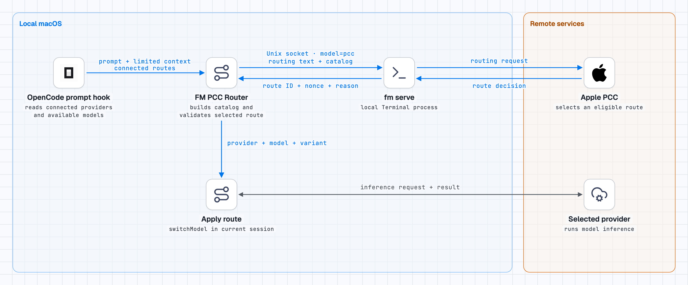
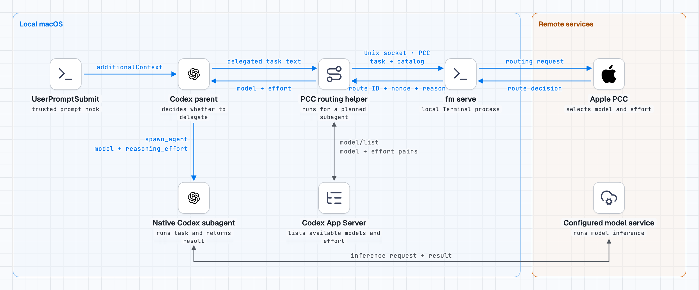

# FM PCC Router

[English](README.md)

Apple Foundation Models와 Private Cloud Compute(PCC)를 이용해 OpenCode 요청을 라우팅하고, Codex 작업을 맡을 서브에이전트의 모델과 추론 강도를 선택합니다.

## `fm serve` 사용 방식

라우터는 Mac의 숨겨진 Terminal 창에서 `fm serve`를 실행해 Apple PCC에 라우팅을 요청합니다. 작업의 모델 추론은 선택된 provider가 실행합니다.

### OpenCode

<picture>
  <source media="(prefers-color-scheme: dark)" srcset="docs/architecture-opencode-dark.png">
  
</picture>

OpenCode는 현재 세션에 선택된 모델을 적용하고, 플러그인이 로드된 동안 서버를 재사용합니다.

### Codex

<picture>
  <source media="(prefers-color-scheme: dark)" srcset="docs/architecture-codex-dark.png">
  
</picture>

Codex 도구는 서브에이전트 라우팅을 요청할 때 서버를 띄우고 모델을 고른 뒤 종료합니다.

## 요구사항

- Apple Intelligence와 PCC를 사용할 수 있는 macOS 27 이상
- Node.js 20 이상 및 릴리스 설치에 필요한 Git
- OpenCode 라우팅에는 OpenCode 2 데스크톱 앱과 연결된 provider
- Codex에는 모델·추론 강도를 지정해 서브에이전트를 시작할 수 있는 세션이 필요합니다. 라우터는 ChatGPT 데스크톱 앱에 포함된 App Server도 사용할 수 있습니다.

## 설치

```sh
npx skills add mindarlynn/fm-pcc-router
```

`fm-pcc-router`에 `https://github.com/mindarlynn/fm-pcc-router.git`과 릴리스 태그 또는 전체 커밋 SHA를 알려주고 설치를 요청합니다. **OpenCode만**, **Codex만**, **둘 다** 중에서 고릅니다. 요청할 때 설치 대상을 함께 지정할 수도 있습니다.

`skills add`는 설치 스킬을 추가합니다. 스킬을 실행하면 선택한 앱의 라우터가 설치됩니다. 로컬 체크아웃이 있다면 `npx skills add /path/to/fm-pcc-router`를 실행하고, 스킬에 해당 체크아웃 경로를 알려줍니다.

### 설치 후

- **OpenCode** — 앱을 다시 시작하고 평소 프로젝트에서 채팅합니다. 플러그인이 모델을 선택해 자동으로 적용합니다.
- **Codex** — 설치기가 Codex 사용자 훅에 FM PCC Router 항목을 추가합니다. **Settings > Hooks**에서 `UserPromptSubmit`을 검토하고 신뢰합니다. 새 채팅에서 Codex에 작업 위임을 요청합니다. Codex가 훅의 지침을 따르면 위임할 작업 설명을 PCC에 보내고, 선택된 모델과 추론 강도로 서브에이전트를 시작합니다. 명시된 설정이 우선합니다.

`$fm-pcc-router`로 작업 하나를 직접 라우팅할 수도 있습니다. 선택 사항인 `PostModelRequest` 훅을 신뢰하면 선택 모델과 서브에이전트 요청에서 관측된 모델을 대조합니다.

첫 PCC 요청에서 macOS가 Terminal 제어 권한을 요청할 수 있습니다. App Server와 Terminal.app을 시작할 때 로컬 실행 승인이 필요할 수 있습니다.

## provider 제한 설정

특정 provider만 선택하도록 제한하려면 전역 설정 `~/.config/opencode/opencode.json` 또는 `opencode.jsonc`의 `plugins` 배열에 아래 항목을 추가합니다. `allowedProviders`에는 OpenCode의 provider ID를 지정합니다.

```json
{
  "$schema": "https://opencode.ai/config.json",
  "plugins": [
    {
      "package": "./plugins/fm-pcc-router/",
      "options": {
        "allowedProviders": ["openai"]
      }
    }
  ]
}
```

목록에 있는 provider 중 연결된 provider만 사용합니다. 빈 목록은 모든 모델 선택을 차단합니다. 예시를 적용할 때 다른 설정과 기존 플러그인 항목은 유지합니다.

## 연결 확인

OpenCode 채팅에서 `/pcc-test`를 입력하면 PCC 연결을 확인할 수 있습니다. 이 진단은 작업을 실행하지 않습니다. 실패하면 Apple Intelligence 사용 가능 여부, PCC 사용 한도, Terminal 제어 권한을 확인합니다.

## 데이터 처리

OpenCode는 라우팅을 위해 현재 요청과 제한된 최근 대화 텍스트를 보냅니다. Codex는 위임 메시지나 `fm-pcc-router`에 명시한 작업을 보냅니다. 두 앱 모두 Apple PCC에 후보 모델 정보를 전달합니다. 라우터는 첨부 파일, 저장소 파일, Codex 대화 기록을 읽지 않습니다. 위임 메시지에 민감한 내용을 넣지 말고, Apple PCC로 작업 텍스트를 전송할 수 있는 환경에서 자동 훅을 사용합니다.

## 제거

**fm-pcc-router**에 OpenCode, Codex 또는 둘 다 제거해 달라고 요청합니다. 해당 앱을 다시 시작합니다. 설치 스킬도 지우려면 스킬을 추가했던 범위에서 `npx skills remove fm-pcc-router`을 실행합니다.

설치 스킬을 이미 지웠다면 아래 기본 경로에서 제거 명령을 실행할 수 있습니다. `XDG_CONFIG_HOME`이나 `XDG_DATA_HOME`을 설정했다면 해당 경로를 사용합니다.

```sh
# OpenCode
/bin/zsh -f ~/.config/opencode/plugins/fm-pcc-router/integrations/opencode/manage.zsh uninstall

# Codex
node ~/.local/share/fm-pcc-router/codex/uninstall.mjs
```

개발과 테스트는 [기여 안내](.github/CONTRIBUTING.md), 릴리스 내역은 [변경 기록](docs/CHANGELOG.md)을 참고하세요.

## 라이선스

[MIT](LICENSE)
