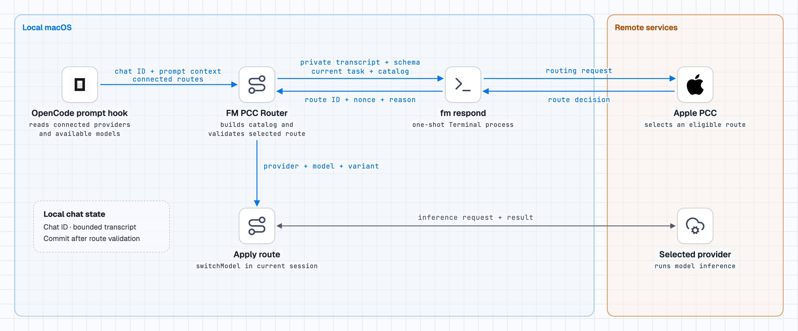
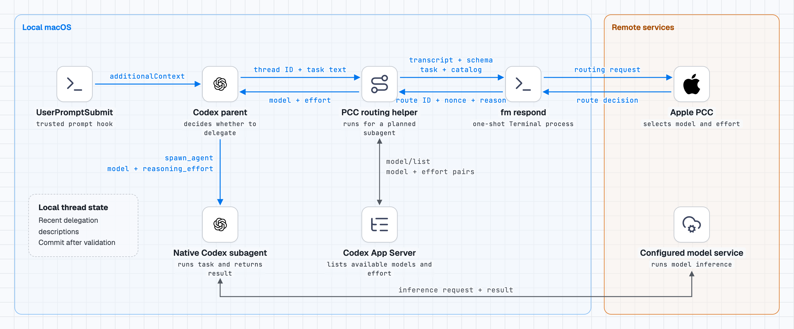

# FM PCC Router

[한국어](README.ko.md)

Uses Apple Foundation Models and Private Cloud Compute (PCC) to route OpenCode requests and select the model and reasoning effort of a Codex subagent.

## How routing works

The router opens a temporary Terminal window and runs `fm respond --model pcc` once per routing decision. It supplies the routing input in a private transcript file and closes the window after the call. The selected provider runs the task's model inference.

### OpenCode

<picture>
  <source media="(prefers-color-scheme: dark)" srcset="docs/architecture-opencode-dark.png">
  
</picture>

OpenCode uses the current chat's recent history and keeps routing state keyed to that chat. A validated route is applied to the current session. Deleting a chat clears its local routing state.

### Codex

<picture>
  <source media="(prefers-color-scheme: dark)" srcset="docs/architecture-codex-dark.png">
  
</picture>

The Codex helper runs when the parent requests a subagent route. It reuses recent delegation descriptions from the same Codex thread when a thread ID is available.

## Requirements

- macOS 27 or later with Apple Intelligence and PCC available.
- Node.js 20 or later and Git.
- OpenCode 2 desktop app and a connected provider for OpenCode routing.
- For Codex, a session with native subagents that accept model and reasoning effort overrides. The router can use the App Server bundled with the ChatGPT desktop app.

## Installation

```sh
git clone https://github.com/mindarlynn/fm-pcc-router.git
cd fm-pcc-router
node install.mjs
```

Choose **OpenCode**, **Codex**, or **both** when prompted. To skip the prompt, pass `--target opencode`, `--target codex`, or `--target both`. To upgrade an existing installation, run `node install.mjs --uninstall` for the affected hosts before installing the new version.

### After installation

- **OpenCode** — Restart OpenCode, open your usual project, and chat as usual. The plugin selects a model and applies it automatically.
- **Codex** — The installer adds the `fm-pcc-router` skill and registers Codex user hooks. Quit the Codex app with **Cmd+Q** and reopen it to load the new hooks. Then review and trust `UserPromptSubmit` in **Settings > Hooks**. In a new chat, ask Codex to delegate a task. The hook gives Codex routing instructions. When Codex follows them, it sends the task description to PCC and applies the chosen model and effort when it creates the subagent. Explicit settings take precedence.

You can also use `$fm-pcc-router` to route one task explicitly. Trust the optional `PostModelRequest` hook to compare its selected model with the model observed in the subagent's requests.

The first PCC request may need macOS Terminal automation permission. The helper may also need local execution approval to start App Server and Terminal.app.

## Optional provider restriction

To limit selection to specific connected providers, add this entry to the `plugins` array in your global `~/.config/opencode/opencode.json` (or `opencode.jsonc`). Use their OpenCode provider IDs in `allowedProviders`:

```json
{
  "$schema": "https://opencode.ai/config.json",
  "plugins": [
    {
      "package": "./plugins/fm-pcc-router/",
      "options": {
        "allowedProviders": ["openai"]
      }
    }
  ]
}
```

Only connected providers in this list are eligible. An empty list blocks all selection. Preserve unrelated settings and plugin entries when applying this example.

## Connection check

Run `/pcc-test` in an OpenCode chat to check PCC connectivity. This diagnostic does not start a task. If it fails, check Apple Intelligence availability, PCC usage limits, and Terminal automation permission.

## Privacy

For routing, OpenCode sends the current request and limited recent conversation text. Codex sends the current delegation description and any bounded history of prior delegations from the same thread. Both send eligible model metadata to Apple PCC. The router does not read attachments, repository files, or Codex transcripts. Keep sensitive content out of delegation messages and use the automatic hook only where sending task text to Apple PCC is permitted.

Routing records are stored locally under `$XDG_STATE_HOME/fm-pcc-router/sessions` (default `~/.local/state/fm-pcc-router/sessions`). The saved context is limited to eight entries and 6,000 UTF-8 bytes per chat. The router ignores records older than seven days. To clear all saved routing history, remove this directory while the router is idle.

## Removal

```sh
node install.mjs --uninstall
```

Run this from the checkout and choose the apps to remove. Codex removal also removes the installed skill and hook entries. Restart the affected apps.

For development and testing, see the [contribution guide](.github/CONTRIBUTING.md). See the [changelog](docs/CHANGELOG.md) for release history.

## License

[MIT](LICENSE)
